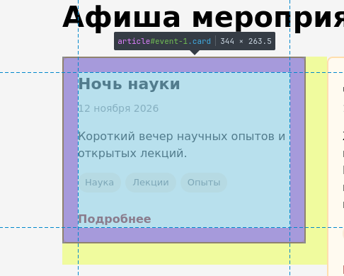
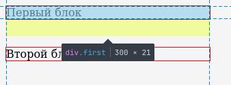
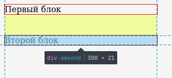

# Ответы по экспериментам

## 1. Размеры карточки

В исходной вёрстке у карточки задано `box-sizing: border-box`. Поэтому `width: 300px`
уже включает в себя внутренние отступы и рамку. Поэтому ширина содержимого - `300 - 20 * 2 - 2 * 2 = 256px`, а внешняя ширина - `300px`.

Если переключить карточку на `content-box`, то `width: 300px` будет шириной только
содержимого. Тогда внешняя ширина станет равна `300 + 20 * 2 + 2 * 2 = 344px`. Этот прогноз совпадает с реальностью:

## 2. Схлопывание отступов

[html](experiment_2/index.html)
[css](experiment_2/style.css)

Соседние вертикальные отступы двух блочных элементов в обычном потоке действительно схлопываются:

Остаётся наибольший отступ `40px`.